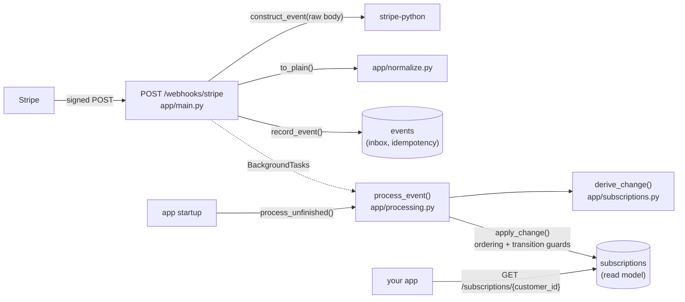
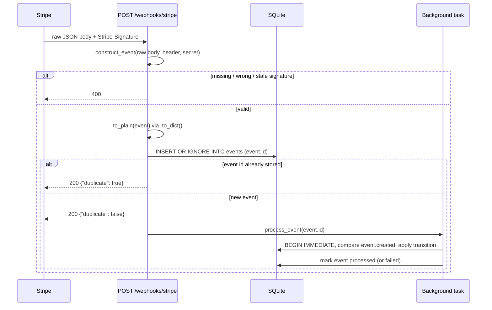

# FastAPI Stripe Webhooks

**Stripe webhook handling in FastAPI that survives real production traffic: verified, idempotent, order-safe and fast to acknowledge.**

[](https://github.com/LuisEduardoGE/fastapi-stripe-webhooks/actions/workflows/ci.yml)
[](LICENSE)


A small, single-concept demo distilled from running Stripe subscriptions in production. Every
piece exists because its absence caused (or would have caused) a real incident.

## Table of Contents

- [Features](#features)
- [Tech Stack](#tech-stack)
- [Architecture](#architecture)
- [Quick Start](#quick-start)
- [Configuration](#configuration)
- [API](#api)
- [Local testing with the Stripe CLI](#local-testing-with-the-stripe-cli)
- [Testing](#testing)
- [Project Structure](#project-structure)
- [Lessons from production](#lessons-from-production)
- [Production checklist](#production-checklist)

## Features

- **Signature verification on the raw body** with `stripe.Webhook.construct_event`; missing, wrong,
  tampered or stale (> 300 s) signatures get `400`.
- **Idempotency by `event.id`**: every verified event is stored in an inbox table; a redelivery is
  acknowledged with `200` and not processed again.
- **Out-of-order safety**: a per-subscription `last_event_created` guard drops events older than the
  state already stored; `canceled` is terminal.
- **Subscription state machine** for `checkout.session.completed`, `customer.subscription.created`,
  `customer.subscription.updated`, `customer.subscription.deleted`, `invoice.paid` and
  `invoice.payment_failed`, with transition guards (e.g. `invoice.paid` never overrides `trialing`).
- **`StripeObject` normalization**: events are converted with `.to_dict()` once, at the edge, so
  handler code never calls dict methods on SDK objects (the bug that kept a paying customer on Free).
- **Fast ack**: the endpoint only verifies, stores and returns; processing runs after the response
  (FastAPI `BackgroundTasks`), and failed or interrupted events are re-driven on startup.
- Handles both invoice shapes: `invoice.subscription` (older API versions) and
  `invoice.parent.subscription_details.subscription` (API `2025-03-31` and later).

## Tech Stack

| Layer | Choice |
|---|---|
| Language | Python 3.12 |
| Web framework | FastAPI 0.165, Uvicorn |
| Stripe SDK | stripe-python 17.1.0 |
| Storage | SQLite via the stdlib `sqlite3` module |
| Tests / lint | pytest, FastAPI `TestClient`, ruff |
| CI / runtime | GitHub Actions, Docker |

## Architecture



The endpoint does the minimum that must happen before Stripe gets a response: verify the signature,
normalize the event and insert it into the `events` table (the primary key on `event.id` is the
idempotency check). Everything else happens after the `200`. `app/subscriptions.py` is pure: it maps an
event to a `Change`; `app/store.py` applies it inside `BEGIN IMMEDIATE` so the "is this event newer?"
check and the write are atomic.

One delivery, end to end:



### State machine

| Event | Change | Applied only if |
|---|---|---|
| `checkout.session.completed` (`mode=subscription`) | link customer and subscription; `active` when `payment_status` is `paid` or `no_payment_required` | - |
| `customer.subscription.created` / `.updated` | status, price and `cancel_at_period_end` from the snapshot | - |
| `customer.subscription.deleted` | `canceled` | - |
| `invoice.paid` | `active` | current status is `incomplete`, `past_due` or `unpaid` |
| `invoice.payment_failed` | `past_due` | current status is `active` or `trialing` |

On every event: if `event.created` is older than the stored `last_event_created` the outcome is
`stale`; a `canceled` subscription never changes again (`terminal`). The plan is `pro` while any
subscription is `active` or `trialing`, otherwise `free`. Every processed event records its outcome
(`created`, `applied`, `stale`, `terminal`, `no-op`, `ignored`, `unhandled`) in the `events` table.

## Quick Start

Prerequisites: Python 3.12+ (and optionally the [Stripe CLI](https://docs.stripe.com/stripe-cli) and Docker).

```bash
cp .env.example .env            # then set STRIPE_WEBHOOK_SECRET
make install
STRIPE_WEBHOOK_SECRET=whsec_... make run        # http://localhost:8000
```

Without make:

```bash
python -m venv .venv && source .venv/bin/activate   # Windows: .venv\Scripts\activate
python -m pip install -r requirements-dev.txt
export STRIPE_WEBHOOK_SECRET=whsec_...
python -m uvicorn app.main:create_app --factory --reload --port 8000
```

With Docker:

```bash
make docker-build
STRIPE_WEBHOOK_SECRET=whsec_... make docker-run   # or: docker run --rm -p 8000:8000 -e STRIPE_WEBHOOK_SECRET fastapi-stripe-webhooks
curl localhost:8000/health
```

Behind a TLS-intercepting proxy, pass its CA bundle to pip at build time:
`make docker-build DOCKER_BUILD_ARGS="--secret id=pip_cert,src=/path/to/ca-bundle.pem"`.

## Configuration

| Variable | Default | Purpose |
|---|---|---|
| `STRIPE_WEBHOOK_SECRET` | *(empty)* | Signing secret of this endpoint (`whsec_...`). If unset, the webhook returns `500` so Stripe keeps retrying until it is configured. |
| `DATABASE_PATH` | `webhooks.db` (`/data/webhooks.db` in Docker) | SQLite file holding the event inbox and subscriptions. |
| `STRIPE_WEBHOOK_TOLERANCE` | `300` | Maximum age in seconds of the signed timestamp (replay protection). |

The app reads the process environment only; `.env.example` lists the variables.

## API

| Method | Path | Response |
|---|---|---|
| `POST` | `/webhooks/stripe` | `200 {"received": true, "duplicate": false\|true}`; `400` bad signature or payload; `500` secret not configured |
| `GET` | `/subscriptions/{customer_id}` | `{"customer_id", "plan": "pro"\|"free", "subscriptions": [...]}` (read model for the demo) |
| `GET` | `/health` | `{"status": "ok"}` |

Interactive docs at `/docs` while the app runs.

## Local testing with the Stripe CLI

```bash
stripe login
stripe listen --forward-to localhost:8000/webhooks/stripe
# prints "Your webhook signing secret is whsec_..." -> start the app with that value:
STRIPE_WEBHOOK_SECRET=whsec_... make run

# in a third terminal
stripe trigger checkout.session.completed
stripe trigger customer.subscription.created     # creates a test subscription; also fires invoice.* events
```

The `stripe listen` secret is different from the secret of a Dashboard endpoint: each endpoint has its
own. The CLI's `checkout.session.completed` fixture is a one-time payment, so it is stored with outcome
`ignored`; use `customer.subscription.created` to exercise the subscription path. Inspect outcomes with
`sqlite3 webhooks.db "select id, type, status, outcome from events"` and
`curl localhost:8000/subscriptions/cus_...`. Resending an event from the Dashboard to a deployed
endpoint returns `{"duplicate": true}` and changes nothing.

## Testing

```bash
make test     # 25 tests, no network, no Stripe keys
make lint     # ruff check + ruff format --check
```

Tests sign payloads locally exactly as Stripe does (`HMAC-SHA256("{t}.{raw body}")` with a fake
`whsec_test_fake` secret, header `t=...,v1=...`) and post them through FastAPI's `TestClient`.

| File | Covers |
|---|---|
| `tests/test_signature.py` | valid event processed; missing header, wrong secret, tampered body, re-serialized JSON and stale timestamp rejected with `400`; rejected requests not stored; missing secret returns `500` |
| `tests/test_idempotency.py` | duplicate delivery acked and processed once; unhandled event types acked; a handler failure after the ack stays `failed` and is re-driven |
| `tests/test_state_machine.py` | checkout (paid and pending async payment), one-off checkout ignored, created, out-of-order update ignored, `payment_failed` -> `past_due`, `invoice.paid` recovery (new invoice shape), trial not overridden, `deleted` -> `canceled` and terminal, unknown customer |
| `tests/test_normalization.py` | a real `stripe.Event.construct_from(...)` object: not a dict, `.get()` raises, `to_plain()` gives nested dicts, and the handler puts the paying customer on `pro` |
| `tests/test_health.py` | health check |

## Project Structure

```text
app/
  main.py            FastAPI app factory and the three endpoints
  normalize.py       to_plain(): StripeObject -> plain dict (the .get() fix)
  subscriptions.py   pure state machine: event -> Change, plan_for()
  store.py           SQLite event inbox + subscriptions, ordering guard
  processing.py      handle/process events after the ack, re-drive unfinished ones
  config.py          settings from environment variables
tests/               pytest suite + local Stripe signing helpers (stripe_fakes.py)
Dockerfile           slim image, non-root, SQLite on a /data volume
Makefile             install / run / test / lint / clean / docker-build / docker-run
```

## Lessons from production

**1. Verify the raw body, not parsed JSON.** The `v1` signature is an HMAC of `"{timestamp}.{body}"`
over the exact bytes Stripe sent. A Pydantic body model or `await request.json()` followed by
`json.dumps()` produces the same data with different bytes (whitespace, key order, unicode escapes), and
verification fails. The endpoint reads `await request.body()` and passes those bytes to
`construct_event`; `test_reserialized_json_fails_even_though_content_is_identical` shows the failure.
The timestamp is part of the signed string, so a captured request cannot be replayed after the
tolerance window.

**2. Deliveries are at-least-once.** Stripe retries any non-2xx response (in live mode for up to three
days) and may deliver the same event more than once even after a 2xx. `event.id` is the idempotency
key: the inbox insert either wins (process it) or is ignored (answer `200`, do nothing). Answering a
duplicate with an error would only cause more retries.

**3. Deliveries are not ordered.** A retry of an old `customer.subscription.updated` can arrive after a
newer one. Each subscription row stores the `created` timestamp of the last event applied, and older
events are skipped. `created` has one-second resolution, so events from the same second are applied in
arrival order; when that is not good enough, re-fetch the object from the API on each event instead of
trusting the payload.

**4. `StripeObject` is not a dict.** The incident: webhook handlers read fields with `obj.get("x")` and
were unit-tested with plain-dict fixtures, so the tests passed. Under a stripe-python version where
`StripeObject` is no longer a `dict` subclass, the first real `checkout.session.completed` raised inside
the handler and a customer who had paid stayed on the Free plan. Checked against the installed packages:

| stripe-python | `issubclass(StripeObject, dict)` | `obj.get("status")` |
|---|---|---|
| 14.0.0 | `True` | works |
| 15.0.0 | `False` | `AttributeError: get` |
| 16.0.0, 17.1.0 | `False` | `AttributeError: 'get' is a dict method, but a Subscription is not a dict. Use .to_dict() to convert it.` |

In 17.1.0, `obj["status"]` and `obj.status` still work, `"status" in obj` is supported, `dict(obj)` raises
`TypeError`, and `to_dict()` (signature `to_dict(recursive=True, for_json=False)`) returns nested plain
`dict`/`list` values. The fix is to normalize once at the edge (`app/normalize.py`) so all handler code
sees the same shape the tests use, and to test with `stripe.Event.construct_from(...)` rather than a dict.

**5. Acknowledge fast, process later.** Stripe expects a quick 2xx and treats slow responses as failed
deliveries, which then retry. The endpoint only verifies and stores the event; the work runs after the
response. Here that is a FastAPI `BackgroundTasks` call in the same process; in production it is a queue
(Celery, RQ, SQS, ...) fed from the same inbox. Because the event is stored before the `200`, a crash or
a handler bug does not lose it: it stays `pending`/`failed` and `process_unfinished()` re-drives it on
startup. Stripe will not retry it for you once it has received a 2xx.

## Production checklist

- Read the **raw request body** for verification; never re-serialize before `construct_event`.
- Use **one signing secret per endpoint** (Dashboard endpoint, `stripe listen`, each environment), loaded
  from the environment, never committed.
- Keep an **idempotency store** keyed by `event.id`, written before you acknowledge.
- **Return 2xx fast**; do the real work in a queue or background worker with its own retries and alerts.
- Guard state transitions against **out-of-order and replayed** events.
- **Normalize SDK objects** (`.to_dict()`) before business logic, and test with real `stripe.Event` objects.
- **Monitor failed deliveries** in the Stripe Dashboard (Workbench / webhook endpoint page) and alert on
  your own `failed` inbox rows.
- **Rotate the signing secret** from the Dashboard when it may have leaked; Stripe can keep the old one
  valid for a grace period while you deploy the new one.

## Author

**Luis Eduardo G. Espindola** · [GitHub](https://github.com/LuisEduardoGE) · [LinkedIn](https://www.linkedin.com/in/luisgespindola/)

## License

[MIT](LICENSE) © Luis Eduardo G. Espindola
