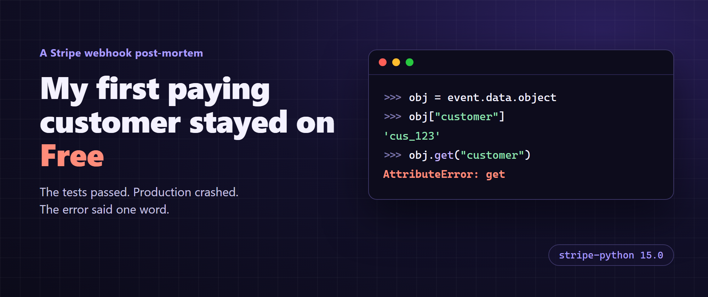
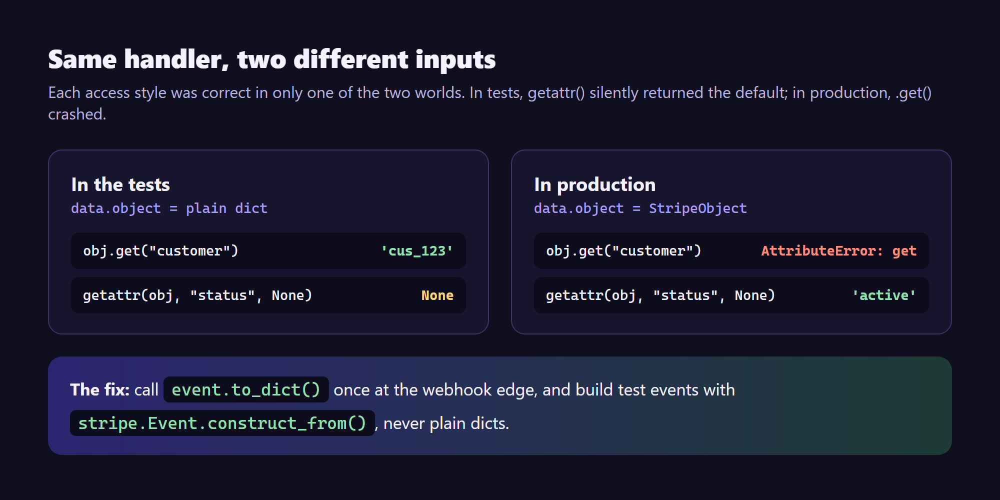

The admin alert had one word in it.

```text
Stripe webhook failed: Error: get
```

Not a stack trace, not a field name. Just `get`.

It was 24 June 2026, and that alert belonged to the first real paying customer of
a home-search subscription product I lead. They had paid for Pro. Stripe had taken the money. Our database still had
them on Free, which meant no Pro alerts, which meant the one thing they had just paid for wasn't happening.


The tests were green. They had been green the whole time. This is the story of why, and of the five lines that fixed it.

## The handler that passed every test

The webhook looked like most Stripe webhooks you will find in tutorials, simplified here:

```python
@router.post("/webhooks/stripe")
async def stripe_webhook(request: Request):
    event = stripe.Webhook.construct_event(
        await request.body(),
        request.headers["stripe-signature"],
        settings.stripe_webhook_secret,
    )
    obj = event["data"]["object"]

    if event["type"] == "checkout.session.completed":
        customer_id = obj.get("customer")
        subscription_id = obj.get("subscription")
        activate_pro(customer_id, subscription_id)
```

And the tests built events the way most of us do, as plain dictionaries:

```python
def _make_event(event_type: str, obj: dict) -> dict:
    return {"type": event_type, "data": {"object": obj}}
```

Plain dicts have `.get()`. So every test called `obj.get("customer")` on a dict, got `"cus_123"`, and passed.

Production doesn't hand you a dict. `stripe.Webhook.construct_event()` returns a `stripe.Event`, and everything inside it is a
`StripeObject`.

## StripeObject stopped being a dict

For years `StripeObject` was a `dict` subclass, so `.get()` just worked and nobody had a reason to notice the difference.
In stripe-python 15.0 it stopped being one. I checked each version against the installed package:

- **14.0.0:** `StripeObject` is a `dict` subclass, and `obj.get("status")` works.
- **15.0.0:** not a `dict` any more, and `obj.get("status")` raises `AttributeError: get`.
- **16.0.0 and 17.1.0:** still not a `dict`, and the error finally explains itself:
  `AttributeError: 'get' is a dict method, but a Subscription is not a dict. Use .to_dict() to convert it.`

Newer versions explain themselves. 15.0 doesn't, and that's where the one-word alert comes from. `StripeObject` resolves
unknown attributes through `__getattr__`, which looks the name up as a key: `obj.get` becomes `obj["get"]`. There is no
`"get"` key in a checkout session, so the `KeyError` is re-raised as `AttributeError("get")`, and `str()` of that
exception is the bare word `get`. My alert printed `str(exc)`. That's the whole message.

![Five steps in stripe-python 15.0: obj.get("customer") goes to StripeObject.__getattr__("get"), which looks up obj["get"]; the missing key becomes AttributeError("get"), and the alert prints str(exc): Stripe webhook failed: Error: get. From 16.0 the error reads: 'get' is a dict method, but a Session is not a dict. Use .to_dict() to convert it](why-get.png)

Here is the trap in a few lines you can run:

```python
import stripe

session = {"object": "checkout.session", "customer": "cus_123"}
event = stripe.Event.construct_from(
    {"id": "evt_1", "object": "event",
     "type": "checkout.session.completed",
     "data": {"object": session}},
    "sk_test_fake",
)
obj = event.data.object

isinstance(obj, dict)  # False
obj["customer"]        # 'cus_123'  item access works
obj.customer           # 'cus_123'  attribute access works
obj.get("customer")    # AttributeError: get  (15.0)
```

Item access works, attribute access works, and the one method every Python developer reaches for doesn't.

## The second trap was hiding in the same file

While fixing it I found a handler that had the opposite problem. `customer.subscription.updated` used attribute-style access with a
default:

```python
status = getattr(obj, "status", None)
```

On a real `StripeObject` that returns the status. On the plain dict the tests used, `getattr(some_dict, "status", None)`
doesn't read keys at all, so it returns the default, `None`, every time, without an error.

So the billing router held two handlers, and each one was correct in only one world:

- `.get()` handlers passed the tests and crashed in production.
- `getattr()` handlers worked in production and were quietly wrong in the tests.

The tests weren't testing the code that runs. They were testing a version of it that receives a different type.



## The fix: one shape, chosen at the edge

The fix is small. Convert the SDK object to plain Python once, right after verifying the signature, and let every
handler see the same shape the tests use:

```python
from collections.abc import Mapping
from typing import Any

from stripe import StripeObject


def to_plain(obj: StripeObject | Mapping[str, Any]) -> dict[str, Any]:
    """Plain, recursively converted dict for a Stripe object."""
    if isinstance(obj, StripeObject):
        return obj.to_dict()  # recursive by default
    if isinstance(obj, Mapping):
        return dict(obj)
    raise TypeError(f"not a StripeObject: {type(obj).__name__}")
```

`to_dict()` is public and recursive, so nested objects (line items, the invoice's subscription details) become plain
dicts and lists too. After that, `.get()` is correct everywhere, and I changed the `getattr()` handler to `.get()` as well
so there is one access style in the file.

Then the part that actually prevents the next one: the tests stopped using hand-made dicts for events. They build the same
class production receives:

```python
def _real_event(evt: dict) -> stripe.Event:
    return stripe.Event.construct_from(evt, "sk_test_fake")


def test_handler_works_on_a_real_stripe_event(tmp_path):
    """A paid checkout must put the customer on the paid plan."""
    store = Store(str(tmp_path / "t.db"))
    paid = checkout_session(payment_status="paid")
    real = _real_event(event("checkout.session.completed", paid))

    assert handle_event(store, real) == "created"
    [sub] = store.subscriptions_for("cus_123")
    assert sub["status"] == "active"
```

That test fails on the old handler and passes on the new one. The dict-based tests never could have told the difference.

## Fixing the customer, not just the code

Deploying the fix didn't fix the customer. Their checkout event had failed, so we never stored their Stripe subscription
ID, and our "sync my plan" button needed exactly that ID to ask Stripe for the current state. The customer couldn't
repair it themselves.

I replayed their state from Stripe: looked up the customer's subscription in Stripe and wrote it to our database, the
way the webhook should have.

If your webhook has failed for real customers, check that your recovery path doesn't depend on data the failed webhook
was supposed to write.

## What I do with Stripe webhooks now

I rebuilt the whole pattern as a small public demo, [fastapi-stripe-webhooks](https://github.com/LuisEduardoGE/fastapi-stripe-webhooks)
(25 tests, no Stripe keys needed). The short version:

1. **Normalize at the edge.** `to_dict()` once, right after `construct_event`. No handler ever touches a `StripeObject`.
2. **Test with the real class.** `stripe.Event.construct_from(...)` in fixtures, not dicts.
3. **Verify the raw body.** `await request.body()`, never parsed and re-serialized JSON, or the signature check fails.
4. **Store before you acknowledge.** Keep an inbox keyed by `event.id`: it makes retries idempotent, and a handler crash
   leaves a `failed` row you can re-run instead of a lost event.
5. **Answer fast, work later.** Return `200` once the event is stored; do the work in a background job.
6. **Log the exception type, not just `str(exc)`.** `AttributeError: get` says far more than `get`.


The bug was one method call. What it cost was the first impression of the first person who trusted us with money.
Since then, every Stripe test I write starts from a real `stripe.Event`.

Have you been caught by an SDK object that looks like a dict but isn't? I'd like to hear which library got you.

---

*Luis Eduardo G. Espindola: full-stack developer (Python and TypeScript) in Belgium.*\
*Code: [github.com/LuisEduardoGE/fastapi-stripe-webhooks](https://github.com/LuisEduardoGE/fastapi-stripe-webhooks)*\
*Elsewhere: [GitHub](https://github.com/LuisEduardoGE) · [LinkedIn](https://www.linkedin.com/in/luisgespindola/)*
